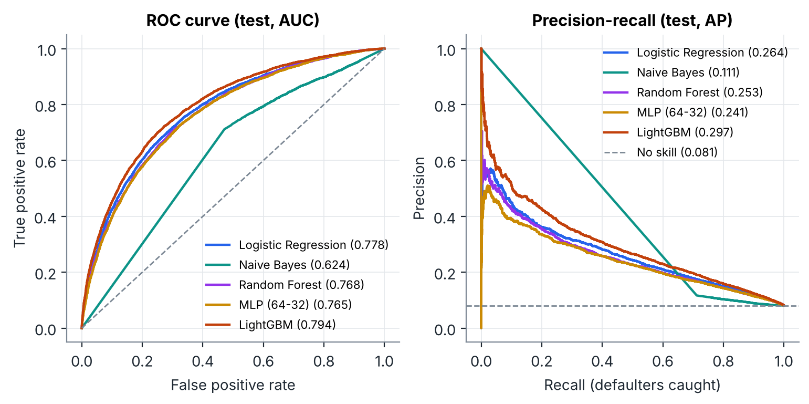

# Loanliness: predicting loan repayment ability

UE24CS352A Machine Learning mini-project, PES University.
Reference paper: Liang, Jin & Wang, *Loanliness: Predicting Loan Repayment Ability by Using Machine Learning Methods* (Stanford CS229).

We predict whether a Home Credit applicant will have payment difficulties (`TARGET = 1`) from their loan application and their past borrowing history. The project compares five model families, studies resampling and K-means, and includes a Streamlit demo with per-applicant feature explanations.

## Start here

- **Try the demo:** follow [Setup](#setup), then run `streamlit run app/app.py`. The trained model is included; no training-data download is needed.
- **Read the report:** [project write-up](reports/writeup.pdf).
- **Inspect the evidence:** [experiment results](reports/results.json), [gender ablation](reports/fairness.json), and [training log](reports/train_log.txt).
- **Reproduce the work:** follow [Reproduce the experiments](#reproduce-the-experiments).



## Results (held-out test set, 61,503 applicants, 8.1% defaulters)

| Model | CV ROC-AUC (5-fold) | Test ROC-AUC | Test PR-AUC | Recall @ tuned cut-off | Precision @ tuned cut-off |
|---|---|---|---|---|---|
| **LightGBM** | **0.791 ± 0.002** | **0.794** | **0.297** | 0.44 | 0.29 |
| Logistic Regression | 0.775 ± 0.002 | 0.778 | 0.264 | 0.42 | 0.28 |
| Random Forest | 0.765 ± 0.002 | 0.768 | 0.253 | 0.42 | 0.25 |
| MLP (64-32) | 0.765 ± 0.004 | 0.765 | 0.241 | 0.45 | 0.24 |
| Naive Bayes | 0.586 ± 0.047 | 0.624 | 0.111 | 0.72 | 0.12 |

A model that always predicts "repays" scores 91.9% accuracy and PR-AUC 0.081, so accuracy is not a headline metric here.

Other findings (numbers in `reports/results.json` and `reports/fairness.json`):

* **History is the biggest gain.** LightGBM on the application table alone scores 0.770. Adding 122 features aggregated from bureau records, previous applications, instalment payments, POS/cash and credit-card balances lifts it to 0.794.
* **The threshold matters more than the algorithm.** At a 0.5 cut-off LightGBM is 92.0% accurate but catches 5.7% of defaulters. At the cut-off chosen by cross-validation (0.17) it catches 44%.
* **Resampling did not improve ranking in these runs.** Class weights, undersampling and SMOTE all lower ROC-AUC slightly (by 0.0005 to 0.008).
* **Paper-style comparison.** On a balanced test subset, each model exceeds its corresponding reported paper accuracy; LightGBM scores 72.1% versus 57.5%. This is a comparison across different experiments, not an identical replication.
* **K-means + one model per cluster does not help.** Per-cluster LightGBM scores 0.792 / 0.788 / 0.784 / 0.782 AUC for k = 2..5, all below the single global model (0.794).
* **Works for thin-file applicants.** 0.779 AUC for applicants missing 2+ external scores, 0.785 for those with no credit-bureau record.
* **Gender can go.** `CODE_GENDER` ranks 3rd in importance, but dropping it costs 0.0015 AUC and narrows the gap between the share of men and women flagged as high risk.
* **Simulated screening policy.** Reviewing the riskiest 10% of applicants catches 39% of defaulters and cuts the default rate among approved loans from 8.1% to 5.5%. Reviewing 20% catches 58%.

## Repository layout

```
src/history.py       aggregates the six history tables to one row per applicant
src/data.py          loading, column fixes, feature engineering (row-wise, leak-free)
src/train.py         all experiments -> reports/results.json, figures, saved model
src/fairness.py      gender ablation -> reports/fairness.json
src/plots.py         figures
app/app.py           Streamlit demo (inference only)
app/sample_applicants.csv   300 held-out test applicants for the demo
models/              trained LightGBM model + metadata (threshold, categories, defaults)
reports/figures/     all plots used in the write-up and slides
reports/writeup.pdf  two-page write-up (rebuild with python reports/make_writeup.py)
reports/train_log.txt       log of the full run
scripts/download_data.sh    data instructions and a no-login fallback
```

## Setup

Python 3.10 or newer. Run commands from the repository root.

```bash
git clone https://github.com/Kundhan73/ML_MiniProject.git
cd ML_MiniProject
python3 -m venv .venv
source .venv/bin/activate
pip install -r requirements.txt
```

On macOS, LightGBM may require `brew install libomp`. On Windows, activate the environment with `.venv\Scripts\activate`.

To rebuild the PDF as well, install its optional dependency with `pip install -r requirements-report.txt`.

### Run the demo (no data or training needed)

```bash
streamlit run app/app.py
```

Pick a real held-out applicant (filter to defaulters or repayers) or enter details by hand, including past repayment behaviour. The app shows the probability of default, the approve/review decision at an adjustable threshold, and the ten features that pushed this score up or down (per-applicant SHAP values from LightGBM).

### Reproduce the experiments

1. Accept the competition rules at <https://www.kaggle.com/competitions/home-credit-default-risk/rules>, download the data and unzip it into `data/raw/kaggle/` (about 2.5 GB).
2. Then:

```bash
python -m src.history              # ~1 min, builds data/processed/history_features.pkl
python -m src.train --quick        # 20% sample, ~9 min, writes reports/quick/
python -m src.train                # full run, ~60 min on 2 CPU cores, ~5 GB RAM
python -m src.fairness             # ~3 min
python reports/make_writeup.py
```

The full run overwrites `reports/results.json`, `reports/figures/`, `models/` and `app/sample_applicants.csv`. It checkpoints each experiment to `reports/cache.pkl`, so a crashed run resumes where it stopped.

`bash scripts/download_data.sh` offers an application-table mirror for exploratory training. It omits the history tables and cannot reproduce the committed full-data results or history-dependent write-up. Use the full Kaggle data for those outputs.

## Method

1. **Cleaning.** `DAYS_EMPLOYED = 365243` (a placeholder used for pensioners, 18% of rows) becomes missing plus an indicator flag. The same placeholder in previous-application dates becomes missing. Gender `XNA` becomes missing.
2. **Application features.** 13 engineered: credit/income, annuity/income, annuity/credit (repayment speed), goods price/credit, employment/age, income per family member, mean/min/std and missing count of the three external scores, document count.
3. **History features.** 122, aggregated per applicant: bureau loan counts, active debt, debt/credit ratios and monthly late-payment rates; previous applications approved/refused, amounts and terms; instalments paid late, days past due and underpayment (overall, last year, last 6 months); POS/cash and credit-card days past due and utilisation. The label is never used.
4. **Split.** Stratified 80/20 train/test. The main model comparison uses 5-fold stratified CV. Ablation and resampling experiments use 3 folds; thresholds are selected from out-of-fold training predictions.
5. **Leak-free preprocessing.** Imputation, scaling, one-hot encoding and any resampling sit inside an `imblearn` Pipeline, so they are re-fitted on each training fold. LightGBM uses missing values and categories natively.
6. **Threshold.** Chosen to maximise F1 on out-of-fold training predictions and then applied unchanged to the test set.
7. **Explanations.** LightGBM's built-in SHAP values (`pred_contrib=True`).

## Team

| Member | SRN |
|---|---|
| Kundhan | PES1UG24AM327 |
| Tarun Gowda | PES1UG24AM303 |

## Data and use

The complete Home Credit dataset is not included. Obtain it from the competition under its data-use terms. The repository retains the supplied 300-row, anonymised applicant sample so the demo can run without downloading the full dataset.

This is an academic screening demonstration. Its predictions, threshold and gender analysis are experimental results, not validated lending decisions.
